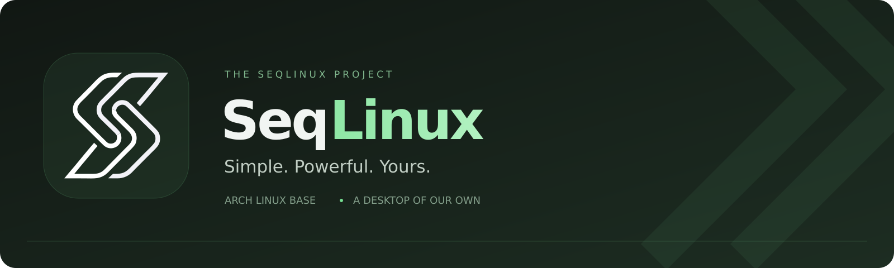

  

  An Arch-based Linux distribution with a desktop of its own.

---

### A desktop that feels like one

SeqLinux brings a focused visual identity and a connected desktop experience
to Arch Linux. Dark surfaces, a green accent, and thoughtful customization —
without getting in the way of your work.

### What we are building

| Project | Purpose |
| :--- | :--- |
| **Seq Desktop** | Our desktop environment, powered by Hyprland and SeqShell. |
| **SeqShell** | A modular Quickshell interface for the panel, launcher, settings, notifications, and lock screen. |
| **SeqLinux Installer** | A graphical installation experience with desktop and bootloader choices. |
| **SeqLinux Packages** | Signed pacman packages for our desktop, branding, and terminal. |

### Built around choice

- **Hyprland stays at the core.** SeqShell adds the desktop interface around it.
- **KDE Plasma is an alternative.** Choose the environment that fits your workflow.
- **Customization belongs to you.** Personal settings stay separate from updatable system components.
- **Updates use pacman.** Our components ship as signed packages alongside the Arch Linux base.

### Project status

SeqLinux is under active development. We are refining the desktop, installer,
hardware compatibility, and release workflow.

Source repositories are currently private while we prepare the project for
publication. Public downloads and contribution information will be announced
here when they are ready.

---

SeqLinux · Simple. Powerful. Yours.

